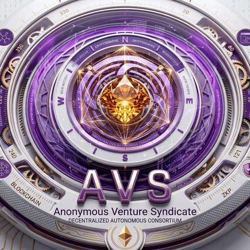
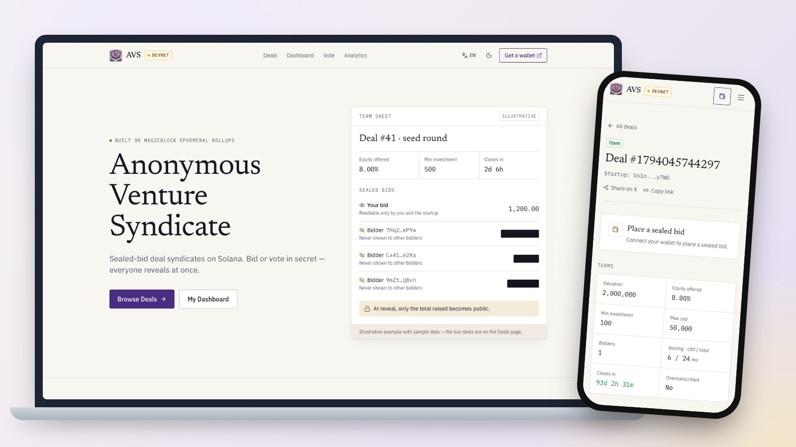
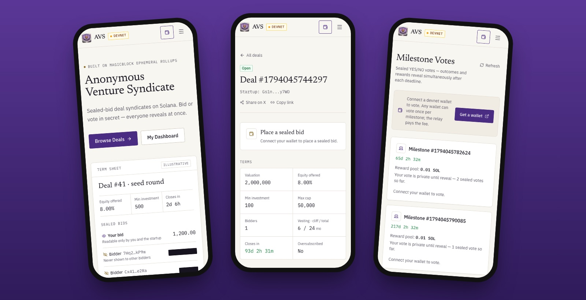
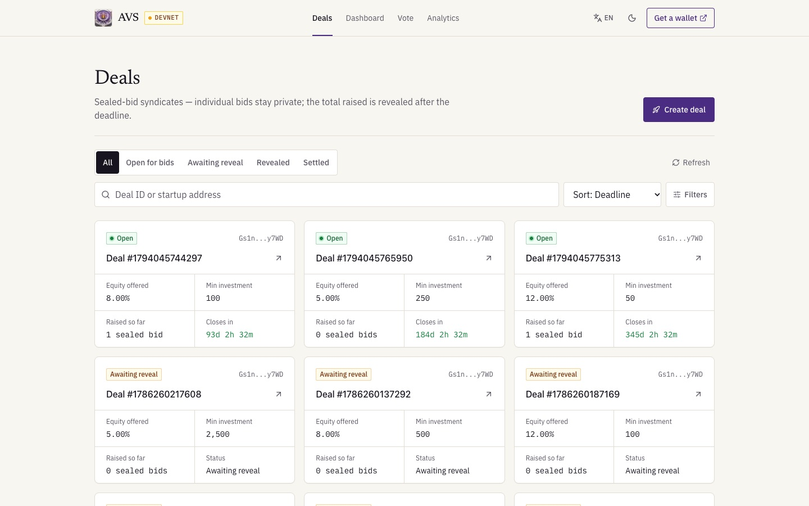
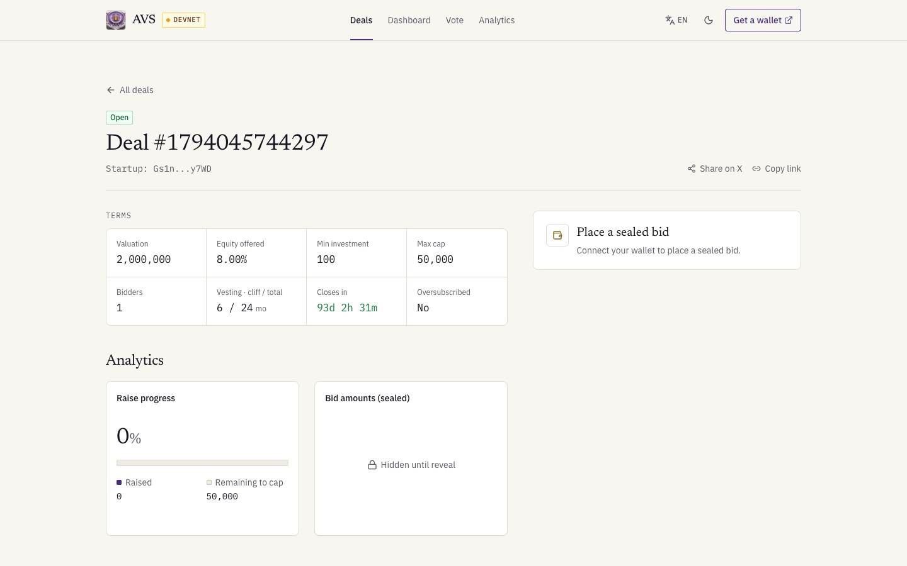
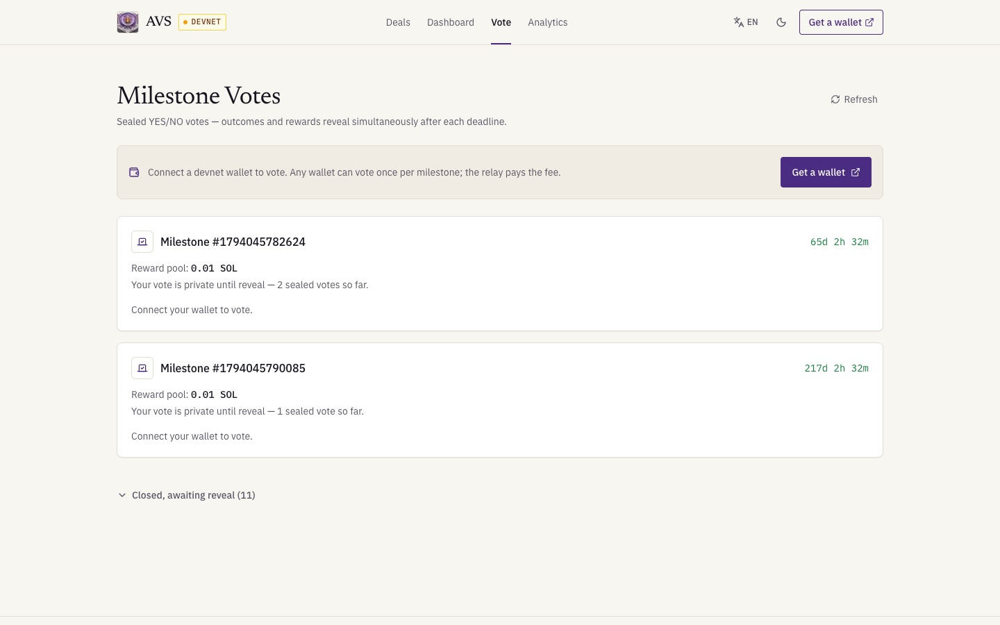
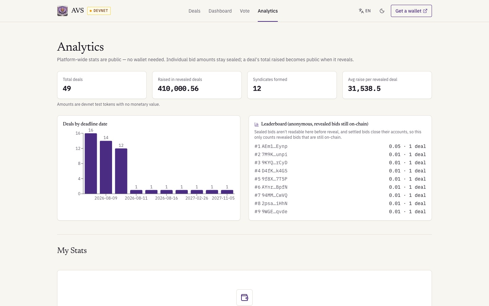
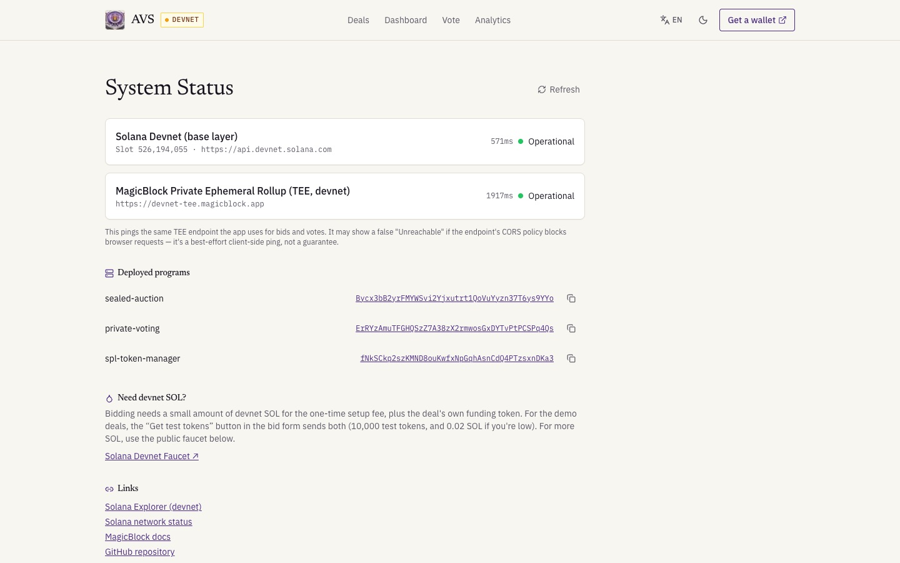
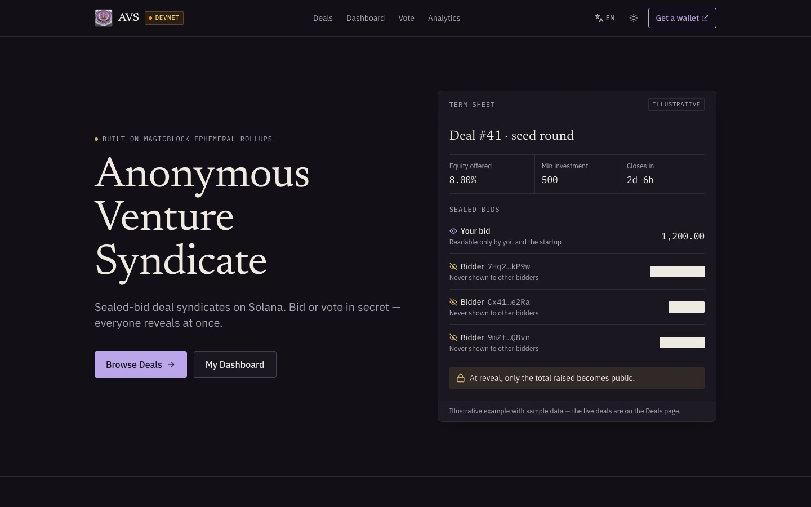
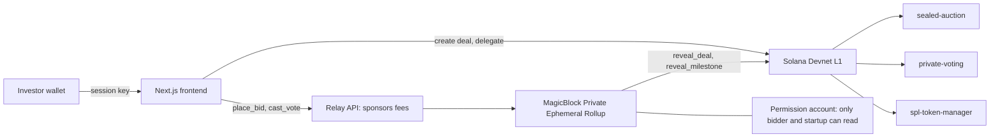

<div align="center">



# Anonymous Venture Syndicate

### Sealed-bid venture syndicates on Solana. Bid or vote in secret — everyone reveals at once.

[](https://avs-mou.vercel.app)
[](https://avs-mou.vercel.app/status)
[](#-hackathon)
[](LICENSE)


<br/>



**[▶ Open the app](https://avs-mou.vercel.app)** · **[Browse deals](https://avs-mou.vercel.app/deals)** · **[How it works](#-how-it-works)** · **[Quick start for judges](docs/QUICKSTART.md)**

</div>

> [!NOTE]
> Everything runs on **Solana Devnet** — no real funds, no mainnet. Every deal, bid and vote shown in the app is real on-chain Devnet state.

---

## 🎯 The problem

On a public blockchain, **every account is readable by anyone**. An Anchor program can restrict who *writes* an account, but it can't stop an RPC node from serving a sealed bid to a competitor who wants to peek before the deadline. Client-side encryption brings its own key-management and reveal-verification problems, and still leaks bid timing and frequency.

That makes a fair, private funding round — where angels can't see or front-run each other's bids — hard to build on plain Solana.

## 💡 The solution

AVS lets **startups post investment deals** and **angel investors place sealed bids** that nobody else can read — only the bidder and the startup.

1. **Post a deal** — the startup publishes terms: valuation, equity %, min investment, cap and vesting.
2. **Sealed bidding** — angels bid through session keys (no wallet popup per bid). Amounts live on a MagicBlock **Private Ephemeral Rollup** behind a Permission account that names only the bidder and the startup as readers.
3. **Simultaneous reveal** — after the deadline the startup reveals the deal: the **total raised** becomes public at once (individual amounts don't), and settlement allocates equity proportionally as SPL tokens.
4. **Private milestone voting** — syndicate members vote YES/NO, sealed the same way. Rewards settle only after an on-chain VRF request is fulfilled, then the pool is split among the winning side.

> "Sealed" here means **access-controlled, not encrypted**: the validator enforces who can read the account until `reveal_deal` / `reveal_milestone` runs. Bids and votes are **fee-sponsored** by a relay that only co-signs sealed-auction and private-voting instructions.

## ✨ Features

<div align="center">

<br/><sub>Mobile: landing · a live deal on Devnet · sealed milestone votes.</sub>
</div>

<br/>

<table>
<tr>
<td width="50%"><p align="center"><sub><b>Deals</b> — filter by status, search by ID or startup address; bid counts are public, amounts are not.</sub></p></td>
<td width="50%"><p align="center"><sub><b>Deal detail</b> — terms, raise progress and bid amounts <i>hidden until reveal</i>.</sub></p></td>
</tr>
<tr>
<td width="50%"><p align="center"><sub><b>Milestone votes</b> — sealed YES/NO votes, relay pays the fee.</sub></p></td>
<td width="50%"><p align="center"><sub><b>Analytics</b> — platform-wide stats read live from Devnet, no wallet needed.</sub></p></td>
</tr>
<tr>
<td width="50%"><p align="center"><sub><b>Status</b> — health of Devnet and the MagicBlock TEE rollup, plus every deployed program.</sub></p></td>
<td width="50%"><p align="center"><sub><b>Dark mode</b> and English/Spanish interface.</sub></p></td>
</tr>
</table>

Also included: a per-deal **test-token faucet**, **session keys** for popup-free bidding, a personal **dashboard**, syndicate pages, equity transfers (SPL) and a local per-browser syndicate chat (not on-chain yet — see `frontend/lib/chatStore.ts`).

## 🧠 How it works



| Program | What it does |
|:--|:--|
| `sealed-auction` | Deals, sealed bids, reveal and proportional settlement |
| `private-voting` | Sealed milestone votes, VRF-gated reward settlement |
| `spl-token-manager` | Equity tokens and transfers |

Full design: [`docs/ARCHITECTURE.md`](docs/ARCHITECTURE.md) · relay: [`docs/RELAY.md`](docs/RELAY.md) · threat model: [`docs/SECURITY.md`](docs/SECURITY.md).

## ⛓️ Deployed programs (Devnet)

| Program | Address |
|:--|:--|
| sealed-auction | [`Bycx3bB2yrFMYWSvi2Yjxutrt1QoVuYyzn37T6ys9YYo`](https://explorer.solana.com/address/Bycx3bB2yrFMYWSvi2Yjxutrt1QoVuYyzn37T6ys9YYo?cluster=devnet) |
| private-voting | [`ErRYzAmuTFGHQSzZ7A38zX2rmwosGxDYTvPtPCSPq4Qs`](https://explorer.solana.com/address/ErRYzAmuTFGHQSzZ7A38zX2rmwosGxDYTvPtPCSPq4Qs?cluster=devnet) |
| spl-token-manager | [`fNkSCkp2szKMND8ouKwfxNpGqhAsnCdQ4PTzsxnDKa3`](https://explorer.solana.com/address/fNkSCkp2szKMND8ouKwfxNpGqhAsnCdQ4PTzsxnDKa3?cluster=devnet) |

## 🛠️ Stack

| Layer | Technology |
|:--|:--|
| Contracts | Rust · Anchor · `spl-token` · `ephemeral-rollups-sdk` (incl. its VRF) · `session-keys` |
| Execution | MagicBlock Private Ephemeral Rollup Permissions — access-controlled reads, relay-sponsored fees |
| Frontend | Next.js 14 · React 18 · TypeScript · Tailwind CSS · Framer Motion · Recharts · Zustand |
| Solana client | `@solana/web3.js` · wallet-adapter · `@coral-xyz/anchor` · MagicBlock SDKs |
| Tests | Anchor/ts-mocha against Devnet · Vitest · Playwright |
| Deploy | Vercel |

## 🚀 Run it locally

```bash
make setup          # install frontend deps
make devnet-setup   # point solana CLI at devnet + airdrop a dev wallet
make build          # compile all programs (cargo build-sbf)
make frontend       # next dev
```

Copy `.env.local.example` → `.env.local` and fill in your own values first. Built on native Windows, so there's no local validator: dev and tests target Devnet.

<details>
<summary><b>More commands and notes</b></summary>

| Command | What it does |
|---|---|
| `make idl` | Generate the IDLs (`anchor idl build`) |
| `make test` | Anchor tests against Devnet |
| `node scripts/seed-demo.cjs` | Re-seed open demo deals and milestones on Devnet when the old ones expire |

Step-by-step setup: [`docs/SETUP.md`](docs/SETUP.md) · Windows toolchain notes: [`docs/WINDOWS_NOTES.md`](docs/WINDOWS_NOTES.md) · judge walkthrough: [`docs/QUICKSTART.md`](docs/QUICKSTART.md).

</details>

## 📂 Docs

| Document | What's in it |
|:--|:--|
| [docs/QUICKSTART.md](docs/QUICKSTART.md) | Walkthrough for judges, why MagicBlock, getting started |
| [docs/ARCHITECTURE.md](docs/ARCHITECTURE.md) | Programs, Ephemeral Rollup privacy model, session keys, relay, frontend |
| [docs/SETUP.md](docs/SETUP.md) | Environment setup, from clone to a working dev loop on Devnet |
| [docs/API.md](docs/API.md) | On-chain instruction reference and the relay's HTTP API |
| [docs/SECURITY.md](docs/SECURITY.md) | Threat model, privacy guarantees, session key and relay risks |
| [docs/SESSION_KEYS.md](docs/SESSION_KEYS.md) · [docs/RELAY.md](docs/RELAY.md) | Session key design · fee-sponsoring relay |
| [docs/KNOWN_ISSUES.md](docs/KNOWN_ISSUES.md) · [docs/FUTURE.md](docs/FUTURE.md) | Open bugs with repro steps · out-of-scope work |
| [docs/AVS_PROJECT_MASTER.md](docs/AVS_PROJECT_MASTER.md) · [docs/AVS_100_TASKS.md](docs/AVS_100_TASKS.md) | Original plan and the 100-task build log |
| [CONTRIBUTING.md](CONTRIBUTING.md) | How to contribute, version pins, code style |

## 📌 Status

All three programs are deployed to Devnet. The full deal lifecycle — create, sealed bids, reveal, settle — and sealed milestone voting work end-to-end through the app, verified live in `tests/*.ts`. A few known issues remain, mostly around undelegating state back to L1 after settlement — see [`docs/KNOWN_ISSUES.md`](docs/KNOWN_ISSUES.md). This is a hackathon project and has not been audited.

## 🏆 Hackathon

Built for the **Solana Blitz V7 Hackathon** (Collaboration Track), on [MagicBlock](https://magicblock.gg) Ephemeral Rollups.

## 📄 License

MIT — see [LICENSE](LICENSE).

---

<div align="center">


**Bid in private. Reveal together.**

</div>
